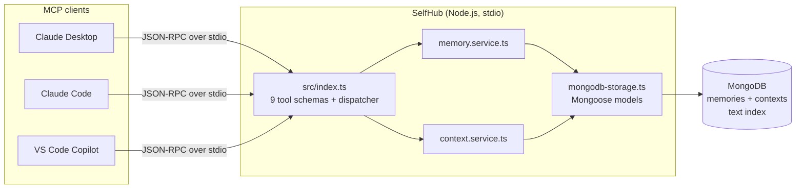

# SelfHub MCP Server

[](https://github.com/Sagargupta16/SelfHub/actions/workflows/ci.yml)
[](LICENSE)

**Your Personal AI Memory Hub** - Store and retrieve your personal data from any MCP-enabled AI assistant.

## 🎯 What is SelfHub?

SelfHub is a [Model Context Protocol (MCP)](https://modelcontextprotocol.io/) server that acts as your personal digital memory. Store notes, preferences, code snippets, tasks, and any information you want - then access them seamlessly from any AI assistant that supports MCP (Claude Desktop, VS Code Copilot, etc.).

Think of it as your **personal knowledge base that travels with you across all AI conversations**.

## Quick start

Pick one way to run it. Each needs a MongoDB; option 1 brings its own.

**1. Docker Compose** (no local Node or MongoDB):

```bash
git clone https://github.com/Sagargupta16/SelfHub.git
cd SelfHub
docker compose build
claude mcp add selfhub -- docker compose -f /absolute/path/to/SelfHub/docker-compose.yml run --rm -T selfhub
```

The client starts MongoDB (data kept in the `selfhub-data` volume) the first time it launches the server. `docker compose up -d mongo` on its own gives you a MongoDB on `localhost:27017` for options 2 and 3. That port is bound on `127.0.0.1`, so stop any local `mongod` already listening on 27017 first.

**2. From source** - see [Setup with Claude Desktop](#-setup-with-claude-desktop) below.

**3. npm, after the first release** (Node 24+, MongoDB at `MONGODB_URI` or `mongodb://localhost:27017/selfhub`). The `selfhub-mcp-server` package is not on npm yet; this works once the `v0.3.0` tag has been published:

```bash
claude mcp add selfhub -e MONGODB_URI=mongodb://localhost:27017/selfhub -- npx -y selfhub-mcp-server
```

### See it work in 10 seconds

```bash
pnpm install
pnpm demo
```

`pnpm demo` starts a throwaway in-memory MongoDB and three separate server processes, one per client. What the first one stores, the next two recall. It never touches `MONGODB_URI`. Real output (IDs are random per run):

```text
[claude-desktop] store_memory {"content":"I use pnpm for every JavaScript project, never npm or yarn","category":"personal","tags":["preferences","tooling"],"importance":5}
  -> stored mem_0921e35e

[claude-desktop] store_memory {"content":"API responses use camelCase keys and ISO 8601 dates","category":"projects","tags":["api"]}
  -> stored mem_245a76c2

[claude-desktop] create_context {"name":"Billing API","type":"project","memoryIds":["mem_245a76c2"]}
  -> created ctx_1cc3a4fc

[claude-code] search_memories {"query":"pnpm"}
  -> 1 result: "I use pnpm for every JavaScript project, never npm or yarn" (score 0.56, relevance high)

[vscode-copilot] activate_context {"id":"ctx_1cc3a4fc"}
  -> Billing API, 1 memory: "API responses use camelCase keys and ISO 8601 dates"

[vscode-copilot] get_stats {}
  -> 2 memories (personal 1, projects 1), 1 context
```

## Architecture

The MCP client launches SelfHub as a child process and talks JSON-RPC over stdio. Every tool call goes through a thin service layer into MongoDB, so the same memories show up in Claude Desktop, Claude Code and VS Code.



### Design decisions

- **stdio transport, no HTTP port** - the client owns the process lifetime, nothing listens on the network, and stdout is reserved for JSON-RPC (all logs go to stderr).
- **MongoDB does the work** - `search_memories` runs one query that combines a `$text` index (content, title, description) with the category, type and tag filters, ranks by `textScore` and returns that score. `list_memories` sorts, skips and limits in MongoDB, so only one page crosses the wire. Indexes are built before the server accepts calls, so the first search on a new database works.
- **Contexts as a second collection** - a context stores memory IDs and each memory stores its `contextId`. `activate_context` loads a project's memories with a single `$in` query and only one context is active at a time. Unknown IDs are never linked, and `delete_memory` pulls the ID out of every context, so `memoryCount` stays accurate.
- **Plays by the stdio lifecycle** - when the client closes stdin, the server closes its MongoDB connection and exits instead of lingering.
- **Readable IDs** - `mem_xxxxxxxx` and `ctx_xxxxxxxx` IDs are easy for a model to quote back in follow-up tool calls.

## 🚀 Setup with Claude Desktop

### Step 1: Install and Build

```bash
git clone https://github.com/Sagargupta16/SelfHub.git
cd SelfHub
pnpm install
cp .env.example .env   # set MONGODB_URI to your MongoDB connection string
pnpm build

# Optional: load sample data
pnpm seed
```

### Step 2: Configure Claude Desktop

Open the Claude Desktop configuration file:

- **Windows**: `%APPDATA%\Claude\claude_desktop_config.json`
- **macOS**: `~/Library/Application Support/Claude/claude_desktop_config.json`
- **Linux**: `~/.config/Claude/claude_desktop_config.json`

Add this configuration (replace with your actual path):

```json
{
  "mcpServers": {
    "selfhub": {
      "command": "node",
      "args": ["C:\\absolute\\path\\to\\SelfHub\\build\\index.js"]
    }
  }
}
```

**Important for Windows:** Use double backslashes (`\\`) in the path!

### Step 3: Restart Claude Desktop

Completely quit and restart Claude Desktop.

### Step 4: Test It!

In Claude, try:

- "List all my memories"
- "Search my memories for typescript"
- "Store that I prefer dark mode in all applications"

## Setup with Claude Code

After building, register the server with one command (use your absolute path):

```bash
claude mcp add selfhub -- node /absolute/path/to/SelfHub/build/index.js
```

## 💻 Setup with VS Code

### Step 1: Build the Server

```bash
pnpm build
```

### Step 2: Configure VS Code

Create `.vscode/mcp.json` in your workspace (replace with your actual path):

```json
{
  "servers": {
    "selfhub": {
      "type": "stdio",
      "command": "node",
      "args": ["C:\\absolute\\path\\to\\SelfHub\\build\\index.js"]
    }
  }
}
```

Then reload VS Code: Press `Ctrl+Shift+P` (or `Cmd+Shift+P` on Mac) → Type "Reload Window" → Press Enter

### Step 3: Test in Copilot Chat

Open GitHub Copilot Chat (`Ctrl+Alt+I`) and try:

```
@workspace list my memories
@workspace search my memories for "typescript"
@workspace store in my memory: I love using pnpm for package management
```

**Note:** You need GitHub Copilot extension installed and enabled.

## 🛠️ Available Tools

### Memory Management (5 tools)

#### 1. `store_memory`

Store new information in your memory hub.

**Example:**

```
Store that I prefer TypeScript over JavaScript for all new projects
```

**Parameters:**

- `content` (required) - The information to store
- `type` - Memory type: `short-term`, `long-term`, `contextual`
- `category` - Category: `personal`, `professional`, `learning`, `projects`, `code`, `tasks`, etc.
- `title` - Optional title
- `tags` - Array of tags
- `importance` - 1-5 importance level

#### 2. `retrieve_memory`

Get a specific memory by its ID.

**Example:**

```
Retrieve memory mem_001
```

#### 3. `list_memories`

List memories with optional filters.

**Example:**

```
List all my professional memories
Show me memories tagged with 'typescript'
List my personal memories
```

**Parameters:**

- `type` - Filter by type
- `category` - Filter by category
- `tags` - Filter by tags
- `contextId` - Filter by context
- `limit` - Max results (default: 50)
- `offset` - Pagination offset

#### 4. `search_memories`

Search through your memories using text queries.

**Example:**

```
Search my memories for "typescript"
Find memories about "API design"
```

**Parameters:**

- `query` (required) - Search query
- `category` - Filter by category
- `type` - Filter by type
- `tags` - Filter by tags
- `limit` - Max results (default: 10)

Each result carries `score` (MongoDB `textScore`, results are sorted by it) and `relevance` (`high`, `medium` or `low` from the memory's importance).

#### 5. `delete_memory`

Delete a memory by ID.

**Example:**

```
Delete memory mem_005
```

### Context Management (3 tools)

#### 6. `create_context`

Create a new organizational context.

**Example:**

```
Create a new context called "Machine Learning Project" for project type
```

**Parameters:**

- `name` (required) - Context name
- `type` (required) - `conversation`, `project`, `topic`, `temporal`
- `description` - Optional description
- `tags` - Array of tags
- `memoryIds` - Initial memory IDs to include

#### 7. `activate_context`

Activate a context and load its memories.

**Example:**

```
Activate the "SelfHub Development" context
```

#### 8. `list_contexts`

List all contexts with optional filters.

**Example:**

```
List all my project contexts
Show active contexts
```

### Analytics (1 tool)

#### 9. `get_stats`

Get usage statistics and insights.

**Example:**

```
Show me my memory statistics
```

**Returns:**

- Total memories count
- Memories by type breakdown
- Memories by category breakdown
- Total contexts
- Most used tags

## 📚 Example Usage Scenarios

### Personal Knowledge Management

```
Store that I prefer dark mode in all applications
Store my favorite TypeScript coding conventions
Remember that I use pnpm for package management
Search my memories for "preferences"
```

### Project Development

```
Create a new context called "SelfHub Development" for project type
Store in SelfHub context: Database schema uses Drizzle ORM
Activate the SelfHub Development context
List all memories in the SelfHub context
```

### Learning & Notes

```
Store as learning: Vector embeddings represent text as numerical arrays
Tag with "machine-learning" and "embeddings"
Search my learning memories for "embeddings"
List all my learning-related memories
```

### Code Snippets

```
Store this code snippet: const sum = (a, b) => a + b
Category: code, Tags: javascript, utility
Search my code for "utility functions"
```

## 🗂️ Sample Data

Run `pnpm seed` to load 6 sample memories into your database:

1. **mem_sample_001** - Dark mode UI preference (personal)
2. **mem_sample_002** - TypeScript best practice (professional)
3. **mem_sample_003** - MongoDB basics (learning)
4. **mem_sample_004** - Documentation update task (tasks)
5. **mem_sample_005** - NPM commands quick reference (code)
6. **mem_sample_006** - SelfHub project overview (projects)

And 2 sample contexts:

1. **ctx_sample_001** - SelfHub Development (project)
2. **ctx_sample_002** - Personal Preferences (topic)

## 🏗️ Project Structure

```
SelfHub/
├── src/
│   ├── index.ts              # Main MCP server
│   ├── seed.ts               # Sample data seeder
│   ├── db/                   # Database layer
│   │   ├── connection.ts
│   │   └── schemas.ts
│   ├── models/               # TypeScript type definitions
│   │   ├── memory.model.ts
│   │   ├── context.model.ts
│   │   └── index.ts
│   ├── services/             # Business logic layer
│   │   ├── memory.service.ts
│   │   └── context.service.ts
│   └── storage/              # Storage implementation
│       └── mongodb-storage.ts # MongoDB persistent storage
├── test/                     # End-to-end tests (MCP SDK client + mongodb-memory-server)
│   ├── harness.ts
│   └── server.test.ts
├── scripts/
│   └── demo.ts               # pnpm demo: three clients, one memory
├── build/                    # Compiled JavaScript output
├── Dockerfile                # Production image (node:24-alpine)
├── docker-compose.yml        # MongoDB + server
├── server.json               # MCP Registry metadata
├── .env.example              # Environment variable template
├── package.json
├── tsconfig.json
└── README.md
```

## 🔧 Development

### Available Scripts

```bash
# Development mode (auto-reload with tsx)
pnpm dev

# Type checking
pnpm typecheck

# Build for production
pnpm build

# End-to-end tests
pnpm test

# Cross-client demo against an in-memory MongoDB
pnpm demo

# Clean build directory
pnpm clean
```

CI runs `pnpm install --frozen-lockfile --ignore-scripts`, `pnpm audit --audit-level=high`, `pnpm typecheck`, `pnpm build` and `pnpm test` on every push and pull request, and builds the Docker image and checks that it answers an MCP `initialize` over stdio.

### Tests

`pnpm test` builds the server, then runs 14 end-to-end tests with `node:test`. Each test spawns `build/index.js` as a real stdio child process, connects with the official MCP SDK client, and runs against a throwaway MongoDB from `mongodb-memory-server` (downloaded on first run). They cover the tool contract (no-argument calls, filters, pagination, context membership, delete cleanup, error results), the first search on a new database, clean exit on stdin close, and two clients sharing one database. Run against the v0.2.5 server, 7 of the 14 fail (6 assertion failures, 1 timeout waiting for the process to exit); all 14 pass on v0.3.0.

### Releases

Pushing a `v*` tag runs [`.github/workflows/release.yml`](.github/workflows/release.yml): it checks that the tag, `package.json` and `server.json` versions match, runs the gates, publishes to npm with trusted publishing (OIDC, no token in secrets), and publishes `server.json` to the [MCP Registry](https://registry.modelcontextprotocol.io) as `io.github.Sagargupta16/selfhub`. Re-running a tag skips the npm step when that version is already on npm.

The first release needs a one-time npm setup, because npm's [trusted publisher docs](https://docs.npmjs.com/trusted-publishers) only describe adding one from an existing package's settings page: publish `0.3.0` once from a local checkout with `npm publish --access public`, then add `Sagargupta16/SelfHub` and `release.yml` as the trusted publisher under the package's Settings on npmjs.com, and push the `v0.3.0` tag so the workflow publishes `server.json` to the MCP Registry. Later versions publish from the tag alone.

### How It Works

1. **MCP Server** (`src/index.ts`) - Implements the MCP protocol, defines 9 tools
2. **Services Layer** - Business logic for memory and context operations
3. **Storage Layer** - MongoDB persistent storage via Mongoose (set `MONGODB_URI` in `.env`)
4. **Models** - TypeScript interfaces for type safety

### Testing Locally

```bash
# Start the server
pnpm dev

# You should see:
# 🚀 SelfHub MCP Server running with MongoDB!
# 💾 Database: Connected and ready
# 🛠️  Available tools: 9 (store, retrieve, search, list, delete, contexts, stats)
```

The server runs on **stdio** (standard input/output) and waits for MCP protocol messages. You cannot interact with it directly - it needs an MCP client like Claude Desktop or VS Code.

## 🐛 Troubleshooting

### Server Not Showing in Claude Desktop

1. **Check the config path:**

   - Make sure you're editing the correct config file
   - Use absolute path, not relative

2. **Verify build exists:**

   ```bash
   ls build/index.js
   ```

3. **Check for typos:**

   - Windows paths need double backslashes: `C:\\path\\to\\`
   - JSON syntax must be valid

4. **Restart Claude completely:**

   - Quit from system tray
   - Wait a few seconds
   - Start again

5. **Check Claude logs:**
   - Windows: `%APPDATA%\Claude\logs`
   - macOS: `~/Library/Logs/Claude`

### VS Code Not Showing Tools

1. **Make sure GitHub Copilot is installed:**

   - Press `Ctrl+Shift+X`
   - Search "GitHub Copilot"
   - Install both "GitHub Copilot" and "GitHub Copilot Chat"

2. **Reload VS Code window:**

   - `Ctrl+Shift+P` → "Reload Window"

3. **Check the build:**
   ```bash
   pnpm build
   ```

### Build Errors

```bash
# Clean and rebuild
rm -rf build node_modules
pnpm install
pnpm build
```

### Data Not Persisting

SelfHub uses **MongoDB persistent storage** - your data survives server restarts. If data isn't persisting:

1. **Check your `.env` file:**

   - Make sure `MONGODB_URI` points to your MongoDB instance
   - Copy from the template if missing: `cp .env.example .env`

2. **Verify the connection:**

   - The server logs `✅ Connected to MongoDB` on startup
   - Without `MONGODB_URI`, it falls back to `mongodb://localhost:27017/selfhub`

## 🔄 Dependency Updates

This project uses [Renovate](https://docs.renovatebot.com/) for automated dependency updates - see `renovate.json`.

## 📖 Documentation

- [Model Context Protocol](https://modelcontextprotocol.io/) - Learn about MCP
- [Claude Desktop](https://claude.ai/download) - Download Claude Desktop
- [GitHub Copilot](https://github.com/features/copilot) - Learn about Copilot

## 🗺️ Roadmap

### Current Version (v0.3.0)

- ✅ MongoDB persistent storage
- ✅ 9 MCP tools
- ✅ Memory categorization and tagging
- ✅ Context management
- ✅ Text-based search
- ✅ Sample data seeder
- End-to-end test suite in CI
- Docker Compose setup
- npm package and MCP Registry metadata, ready to publish from a tag

### Future Enhancements

- [ ] Vector embeddings for semantic search
- [ ] File import/export (JSON, Markdown, CSV)
- [ ] Data encryption for sensitive information
- [ ] Web UI for management
- [ ] Multi-user support
- [ ] Cloud sync

## 🤝 Contributing

Contributions are welcome! Please read [CONTRIBUTING.md](CONTRIBUTING.md) and feel free to submit a Pull Request.

## 📄 License

MIT License - see [LICENSE](LICENSE) file for details.

## 💬 Support

If you have questions or run into issues:

1. Check the [Troubleshooting](#-troubleshooting) section
2. Review the documentation above
3. Open an issue on GitHub

## 🌟 Acknowledgments

Built with:

- [Model Context Protocol SDK](https://github.com/modelcontextprotocol/typescript-sdk) - MCP implementation
- [TypeScript](https://www.typescriptlang.org/) - Type safety
- [pnpm](https://pnpm.io/) - Fast package manager

---

**Made with ❤️ by [Sagargupta16](https://github.com/Sagargupta16)**

_Your personal AI memory hub - remember everything, access anywhere!_
